# Короткая инструкция как работать с Git

Эта инструкция поможет вам создать репозиторий на GitHub, связать его с проектом на компьютере и научиться отправлять туда свои файлы.

Весь процесс состоит из трёх шагов:

1. Создать репозиторий на сайте github.com
2. Создать репозиторий (git) локально, в папке с вашим проектом
3. Связать их между собой и отправить файлы

---

## 1. Создание репозитория на GitHub

Для создания репозитория зарегистрируйтесь на сайте [https://github.com](https://github.com), если ещё не зарегистрированы.

После регистрации перейдите в меню **«Repositories»** («Репозитории»):

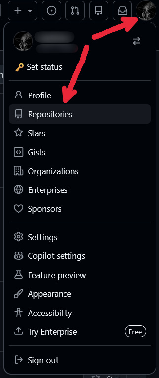

Далее нажмите кнопку **«New»**, чтобы создать новый репозиторий:

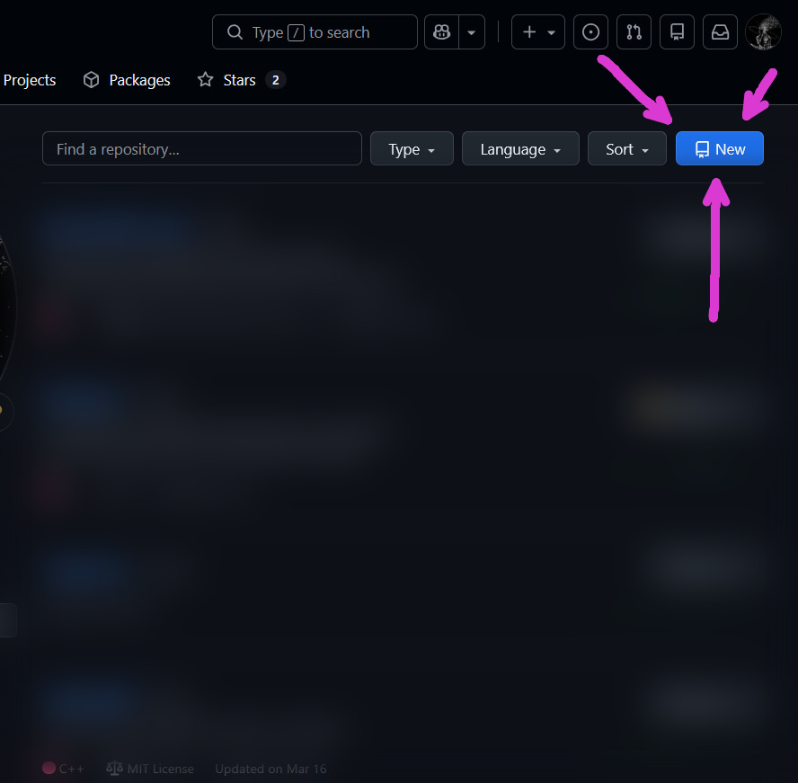

Перед вами откроется форма для заполнения:

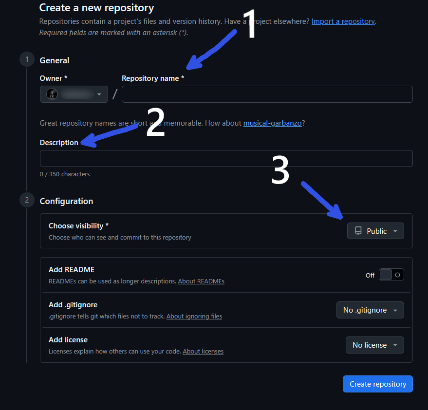

В этой форме нужно заполнить 3 параметра:

1. **Имя репозитория** — обычно совпадает с названием вашего проекта, латиницей, без пробелов
2. **Описание репозитория** (необязательно) — пару слов о проекте
3. **Публичный или приватный репозиторий** — Public (виден всем) или Private (виден только вам и тем, кого вы добавите)

> **После заполнения всех указанных выше полей нажимайте на кнопку «Create repository»**

Репозиторий будет создан, и у вас откроется такое окно:


Не закрывайте эту страницу — она понадобится дальше, чтобы скопировать ссылку на репозиторий.

---

## 2. Создание локального репозитория

Теперь нужно создать git-репозиторий прямо в папке с вашим проектом на компьютере.

**Для этого:**

1. Зайдите в папку с вашим проектом
2. Откройте терминал прямо из этой папки (правой кнопкой мыши по пустому месту в папке → «Открыть в терминале» или похожий пункт)

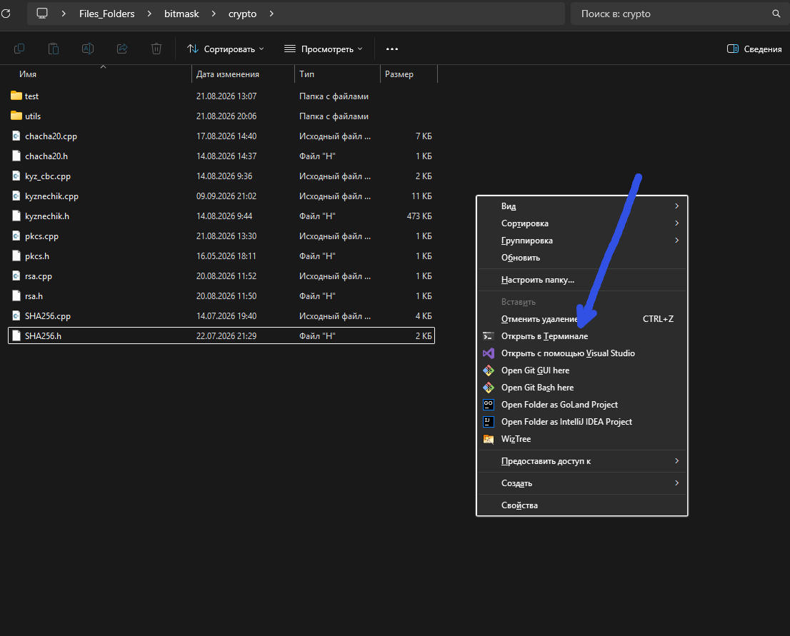

После открытия терминала введите команду:

```
git init
```

Эта команда создаёт локальный репозиторий, который хранится в скрытой папке `.git` рядом с вашим проектом. Она невидима по умолчанию — это нормально, трогать её руками не нужно.

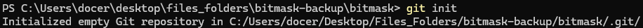

### Настройка имени и почты

Прежде чем начать работать с Git, нужно один раз указать, от чьего имени будут делаться коммиты (это делается один раз на весь компьютер):

```
git config --global user.name "Ваш ник на GitHub"
git config --global user.email "Ваша почта от GitHub"
```

### Привязка к удалённому репозиторию

Вернитесь на сайт github.com, на страницу вашего репозитория, и скопируйте ссылку на него (как на фото):

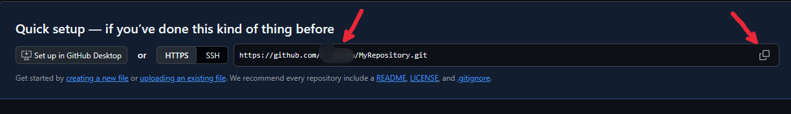

После этого вернитесь в терминал и введите команду, вставив свою ссылку вместо примера:

```
git remote add origin https://github.com/Username/MyRepository.git
```

> ⚠️ Обратите внимание: команда именно `git remote add origin ...`, а не `git add remote origin`. Если написать в неправильном порядке — Git выдаст ошибку.

Теперь Git настроен и готов к работе.

---

## 3. Отправка своего проекта на GitHub

Для отправки проекта откройте терминал в директории вашего проекта и выполните по порядку три команды.

**Шаг 1.** Добавить файлы в индекс:

```
git add .
```

Эта команда добавляет все файлы вашего проекта в следующий коммит (точка означает «все файлы в текущей папке»).

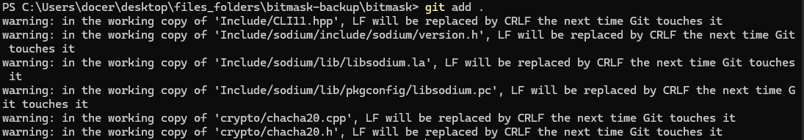

**Шаг 2.** Зафиксировать изменения коммитом:

```
git commit -m "Любое описание изменений"
```

Эта команда подтверждает и фиксирует все добавленные изменения в файлах для дальнейшей отправки их на удалённый репозиторий GitHub. Вместо «Любое описание изменений» напишите коротко, что вы сделали (например: "Добавил главный файл проекта").

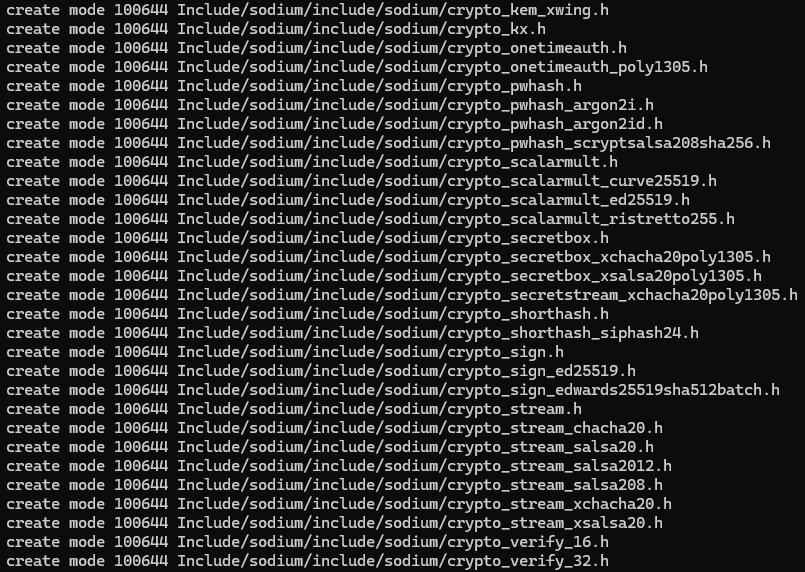

**Шаг 3.** Отправить файлы на GitHub:

```
git push -u origin master
```

### Если возникла ошибка

Если после `git push` у вас появилась такая ошибка:

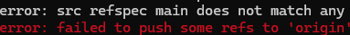

Это значит, что ваша текущая ветка называется не `master`, а, например, `main`. Чтобы узнать точное название, введите команду:

```
git branch
```

Та ветка, которая будет отмечена звёздочкой и подсвечена зелёным — это ваша текущая ветка. Подставьте её название в команду вместо `master`:

```
git push -u origin ТекущаяВетка
```

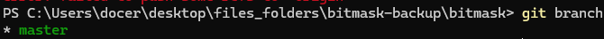

Так выглядит успешная отправка на удалённый репозиторий github.com:

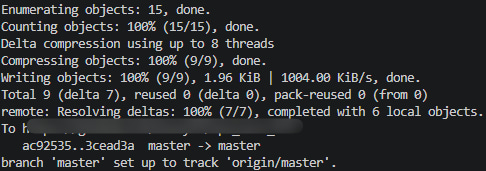

После этого обновите страницу вашего репозитория на github.com — файлы проекта должны появиться там.

---

## Вспомогательные команды Git

| Команда                     | Что делает                                                 |
| --------------------------- | ---------------------------------------------------------- |
| `git status`                | Показывает, какие файлы изменены и готовы ли они к коммиту |
| `git switch -c <Имя ветки>` | Создаёт новую ветку и сразу переключается на неё           |
| `git branch -d <Имя ветки>` | Удаляет ветку локально                                     |
| `git branch`                | Показывает список всех веток и текущую активную            |
| `git log`                   | Показывает историю коммитов                                |
| `git clone <ссылка>`        | Скачивает уже существующий репозиторий к себе на компьютер |

> 💡 Если что-то пошло не так и вы не понимаете ошибку — скопируйте полный текст ошибки из терминала и погуглите её или покажите преподавателю, не пытайтесь угадывать решение наугад.
